# Start here

This is my portfolio. It's a spiral of 10 cards. Click one (or hit Enter) and its panel opens. On phones, or if "reduce motion" is on, you get a plain list of the same sections instead. Everything is in English and Spanish, and the language button flips all of it.

90% of the time I only touch 3 places:

- `src/content` for the text
- `public` for the pictures
- `src/styles/theme.css` for colours and the font

The rest is the stuff that draws the cards. Mostly leave it alone.

Almost every file has a short note at the top saying what it does. Numbers you'd actually want to tweak (how long a photo stays up, how fast the ring text spins) sit at the top of their file with a name and a comment.

Want to see how the parts work together (the spiral, the background, panels, the top bar)? The diagrams in [docs/flowcharts/](docs/flowcharts/README.md) walk through each one.

## Where stuff is



```
portfolio/
  START-HERE.md          this guide
  index.html             tab title and tab icon (before the page loads)
  package.json           the commands: npm run dev, npm run build
  docs/                  the folder map picture above
  public/                every picture and file the site hands out as is
    photos/              portrait, rowing, TECHO
    logos/               school and company logos
    tech-icons/          the small skill logos (Python, React...)
    project-pictures/    the picture on each project card
    cv/                  the two CV PDFs
  src/
    content/             ALL the text, one JSON per section, EN and ES together
    sections/            how each opened card looks (one file per card)
    spiral/              the 3D menu: card faces, corner badge, photo reel
    styles/              theme.css (colours, font) and effects.css (animations)
    components/          shared panel pieces: timeline, tech grid, menu drawer, diagram viewer
    lib/                 small helpers and the list of skill logos
  tools/                 optional scripts for the diagrams. The site never runs them
    project-diagrams/    how the project diagrams and the folder map get drawn
      mermaid/           one text file per diagram and language (.mmd), plus the script
        docs/            the text file for the folder map above
```

Never open `node_modules/` (downloaded packages) or `dist/` (the built site, gets rebuilt every time).

## I want to...

### Change the text of a card

All the words are in `src/content`. Open the card's file, find the sentence, change it. EN and ES sit in the same file under `"en"` and `"es"`. Only change `en` and Spanish keeps the old text.

| Card | File | What's inside |
| --- | --- | --- |
| Hello | `site.json` | `meta` (name, role, tagline, location), `links` |
| About me | `about.json` | `lead`, `points` |
| Experience | `experience.json` | list of entries: period, role, org, place, logo, bullets |
| Things I work with | `skills.json` | `groups` (title and items), `other`, `languages` |
| Education | `education.json` | list of entries: period, title, org, place, logo, url, bullets |
| Projects | `projects.json` | `groups`, `items` (one per project), `art` |
| Rowing | `rowing.json` | `lead`, roster link, `medals` |
| Learning | `learning.json` | `lead`, `points` |
| Leadership | `leadership.json` | `lead`, `items` |
| Contact | `contact.json` | `lead` (email and buttons come from `site.json`) |

Button labels, the corner badge text, picture descriptions and the menu card names are in `interface.json`. `src/content/README.md` explains every key.

### Change the picture, logo or colours of a menu card

`src/spiral/cardFaces.ts`. One table, one entry per card, named by section id (`intro`, `about`, `experience`...). Fields:

- `photo`: `src` is the file in `public` (like `/photos/portrait.webp`). `fx` and `fy` go 0 to 1 and pick which part stays in view when it's cropped. `fx: 0` = left edge, `1` = right. `fy: 0` = top, `1` = bottom.
- `logo`: the logo on the card, a file in `public`.
- `background`: one colour, or two for a diagonal gradient. Education uses three (white centre, two blues).
- `lines`: colour of the rings or outlines on top.
- `logoColor`: fill colour for logos, on the cards that recolour them.
- `titleColor`: `'white'` or `'dark'` for the number and title. `'dark'` on light backgrounds.

Not every field works on every card. Photos only show on Hello, About me and Rowing. Logos only on Experience and Education. Set a field a card doesn't use and nothing happens. New photo? Drop it in `public/photos/` and change `src`. Replace a file with the same name and the card updates with zero edits. Heads up: `portrait.webp`, `rowing-paraguay.webp` and `rowing-hocr.webp` also show inside the opened panels.

Font and sizes of the card art are in `src/spiral/cardStyle.ts`. The lime green is `ACCENT` there.

### Change the pictures inside the opened cards

- Hello: `public/photos/portrait.webp`, named in the `img` near the bottom of `src/sections/Intro.tsx`.
- Rowing: `public/photos/rowing-paraguay.webp` and `rowing-hocr.webp`, named in `src/sections/Rowing.tsx`.
- Leadership (TECHO): `public/photos/techo-1.webp` and `techo-2.webp`, named at the top of `src/components/Timeline.tsx`. `leadership.json` picks them with `"photos": ["techo1", "techo2"]`.

Easiest: replace the file, same name. New name? Change it in the file above. Portrait works best around 2:3, TECHO photos get cropped to 3:4, rowing ones to 4:3. Screen reader descriptions are under `alt` in `interface.json`, update those too.

### Change a project card's picture

They're in `public/project-pictures/`, named `<project-id>.<en|es>.<svg|webp>`, like `sudoku.en.svg` and `sudoku.es.svg`. The id is the project's `id` in `projects.json`. Projects with `"image": "webp"` use `.webp`, the rest `.svg`. The site picks by language, so you need one per language.

7 projects are diagrams (orquestador, pep9, vmm, sched, sudoku, db, web). A script draws them from small text files, not by hand. Each one has two: `tools/project-diagrams/mermaid/<id>.en.mmd` and `<id>.es.mmd`. They're Mermaid, basically a diagram written in words.

To change a label, edit the text inside the quotes, in both languages. `<br/>` breaks a label into two lines. Then:

```
npm run pictures
```

That redraws every diagram, writes the SVGs to `public/project-pictures/` and updates `src/content/pictureSizes.json` on its own (the size of each picture, so the page saves space for it while it loads). Just one diagram: `node tools/project-diagrams/mermaid/build-mermaid.mjs sudoku`. Needs internet (it loads Mermaid from the web) and Edge or Chrome. Without them it says so and changes nothing. Don't edit the SVGs by hand, the next run overwrites them.

Keep diagrams narrow. A phone shows them about 320 px wide, so a wide one = tiny text. If one's too wide the script stops and names the file. Fix: max two boxes per row, shorter labels, or split a long chain into two rows. Nothing gets written until all of them fit.

A small one looks like this:

```
flowchart TD
  A["Input file"] --> B["Main step"]
  B --> C["Result"]
  B -.-> D["Optional step"]
  classDef top stroke:#ededed,stroke-width:2px
  class B top
```

`-->` is a solid arrow, `-.->` dotted. The last two lines give box B a brighter outline. Copy an existing file to see more, like `sudoku.en.mmd`.

New project diagram: copy a pair to `<id>.en.mmd` and `<id>.es.mmd`, edit both, run `npm run pictures`. Picture and size show up by themselves. The folder map at the top works the same: edit `tools/project-diagrams/mermaid/docs/folder-map.mmd`, run `npm run folder-map`.

4 projects are screenshots (catch, dashboard, forecast, portfolio), as `.webp`. To change one, drop any 1500 x 900 `.webp` in `public/project-pictures/` with the same name. The portfolio one is the spiral itself, taken at 1366 x 768 and padded at the bottom to 1500 x 900 (the card fades that edge).

Screen reader text for each picture is `art` at the bottom of `projects.json`.

Tap a diagram and it opens big with zoom buttons (`src/components/DiagramViewer.tsx`). The 4 screenshots are just pictures. On the 7 diagrams you can also tap a box: it lights up with its arrows and a one-line note shows under it.

### Change what a box says when tapped

1. `src/content/projects.json`, find `diagramNotes` (after `art`, once under `en` and once under `es`).
2. Find the project, then the box. Boxes go by their id in the `.mmd` file: in `T["TLB<br/>16 entries"]` the id is `T`.
3. Change the sentence. Keep it short (under ~110 characters), both languages.
4. Run `npm run check-notes`. It says OK, or names a box with no note (like after adding a box to a `.mmd`) or a note for a box that's gone.

The lit-box look (white outline, rest faded) is `.dv-*` in `src/styles/effects.css`. The words around it (card badge, "Tap a box to see what it does", zoom buttons) are `diagram*` and `zoom*` in `interface.json`.

### Add photos to the corner badge and the reel

The corner badge is the small tilted photo bottom left of the spiral. Press it and the photo reel opens. Same photos for both.

1. Drop the photo in `public/photos/`.
2. In `src/spiral/badgePhotos.ts`, add a line with its path, like `'/photos/my-photo.webp',`. They play in that order.

That's it. Dev server not showing it? Refresh. Empty list = plain grey tile that does nothing.

Size tips: ~1600 px on the long side, WebP or JPG (PNG works), under 160 kB each so the reel opens fast. The reel shows every photo whole, so any shape works. The small tile is cropped to 16:9 and hangs off the corner, so only the top right shows. Keep the face up there.

### Change how long a photo stays, or the ring text

- Seconds per photo on the small tile: `SECONDS_PER_PHOTO` in `src/spiral/CornerBadge.tsx` (3.2).
- Ring text speed: `RING_SECONDS_PER_TURN`, same file (12 seconds per turn, smaller = faster).
- Seconds per photo in the reel: `SECONDS_PER_PHOTO` in `src/spiral/PhotoReel.tsx` (1.7). `FADE_SECONDS` there is the crossfade.
- The ring text: `badgeRing` under `ui` in `src/content/interface.json`, `en` and `es`. It repeats to fill the ring, so short is fine. End it with a separator and a space like the current one.
- Tile tilt: `.badge-tile` in `src/styles/effects.css` (`rotate(-15deg)`).

### Change colours and fonts

`src/styles/theme.css`, every group has a note. Main ones:

- `--bg`: page background
- `--fg`: main text
- `--muted`: quieter text
- `--surface`: panels and cards on top of the background
- `--line`: thin borders
- `--chip`: background of the small tag pills
- `--accent-text`: dates, small labels, numbers
- `--color-accent`: the accent, white right now. Buttons, timeline dots, bullets and the progress bar follow it.
- `--color-ink`: text on top of the accent (button labels). Keep it dark while the accent is light.
- `--font-sans`: the font

New font: `npm install @fontsource-variable/<font-name>`, add `import '@fontsource-variable/<font-name>'` in `src/main.tsx` next to the Inter line, and put the name in `--font-sans`. The spiral cards draw titles on a canvas with their own copy of the name: `FONT` in `src/spiral/cardStyle.ts` and the two `document.fonts.load` lines in `src/spiral/cardDrawing.ts`. Change those too or the cards stay on Inter.

Colours that aren't in `theme.css`:

- Menu card faces: `src/spiral/cardFaces.ts`, `cardStyle.ts` and a few in `cardDrawing.ts` (skill tiles). The Projects card is plain white with `public/logos/repo.svg`.
- The mountain landscape behind the spiral: knobs at the top of `src/components/Landscape.tsx` (speed, dot size and spacing, mountain height, haze, twinkle, colours).
- The panel background (black with a grid floor): constants at the top of `src/components/GridBackdrop.tsx`.
- Fog and the dark edge vignette on the spiral: `BG`, `<fog>` and the gradient `div` in `src/spiral/Spiral.tsx`.
- Medal metals: `TONES` at the top of `src/components/Medal.tsx`.
- Diagram pictures: `themeVariables` near the top of `tools/project-diagrams/mermaid/build-mermaid.mjs`, then `npm run pictures`.
- Phone browser bar: `theme-color` in `index.html`.
- A few written straight into components, like `bg-black/50` or `border-white/20`. Search the file for the class.

### Change links, email, LinkedIn, GitHub or the CV

`src/content/site.json`, under `links`: `email`, `linkedin`, `github`, `cv`, once for `en` and once for `es`. Change both. Project links (`live`, `code`) are in `projects.json`, the rowing roster link is `rosterUrl` in `rowing.json`.

The CVs are in `public/cv/`: `Nicolas_Invernizzi_CV_EN.pdf` and `Nicolas_Invernizzi_CV_ES.pdf`. Replace with the same name and the Download CV buttons pick it up. Rename it and you have to change `cv` in `site.json`.

### Change my name, title or tagline

`site.json` under `meta`: `name`, `role`, `tagline`, `location`, plus `title` (tab and search result title) and `description` (search result text). Both languages. `index.html` has its own `<title>` and description too. The site swaps them as soon as it loads, so they only matter for that first moment and for tools that don't run the page. Keep them matching anyway.

### Add a new project

1. In `src/content/projects.json`, copy an entry in `items` (`en` and `es`) and edit it. Fields: `id`, `group` (one of the `groups` ids: rowing, itti, portfolio, marietta), `title`, `tag`, `text`, `details` (bullets), `stack` (tech names), and optional `legal`, `note`, `live`, `code`, `codeLabel`, `image`.
2. Add its picture. Diagram: write `tools/project-diagrams/mermaid/<id>.en.mmd` and `<id>.es.mmd`, run `npm run pictures` (see above). It makes `public/project-pictures/<id>.en.svg` and `<id>.es.svg` and adds the size to `pictureSizes.json`. Screenshot: put `<id>.en.webp` and `<id>.es.webp` in `public/project-pictures/` and add `"image": "webp"` to the project.
3. Add a picture description under `art` at the bottom, as `"<id>": { "label": "..." }`, both languages. For a diagram, also add its box notes under `diagramNotes` and run `npm run check-notes`.
4. `stack` names show as plain text tags. No logo needed.

### Add a skill logo

1. Save it as `public/tech-icons/<slug>.svg`. White or light logos look best on the black tiles.
2. Add a line to `src/lib/techIcons.ts`: the name as written in `skills.json`, then the slug and the hover label.
3. Use that name in `skills.json` under `items` (exact same spelling, caps count).

A name that's not in `techIcons.ts` still shows, just as a plain text tag. The Skills menu card shows logos for the first 30 skills that have one.

### Replace a school or company logo

Logos inside the Experience and Education panels are in `LOGOS` in `src/components/ui.tsx`. Replace the file in `public/logos/` with the same name, or change `src` there. The menu card logos are different files (`itti-white.svg` and `marietta.svg`), set in `cardFaces.ts`.

The panels are black, so two logos use light versions (`marietta-dark.svg`, `cambridge-dark.png`). `marietta.svg` and `cambridge.png` are the originals. Replace one, replace its light version too.

### Change Education or Experience entries

`education.json` or `experience.json`. Each entry is one block on the timeline. Add, remove or reorder, in `en` and `es`. `logo` picks from `LOGOS` (itti, marietta, cambridge, cristorey, techo). `url` makes the org name a link, `"urlOn": "title"` makes the heading the link instead. Education has the school links in `url` right now.

### Change the medals

`src/content/rowing.json` under `medals`. Each has `medals` (`["silver"]`, `["bronze"]` or both), `label`, `event`, `place` and `year`. The drawing is `src/components/Medal.tsx`.

### Change the order or names of the menu cards

`src/content/interface.json`, the `sections` list, in `en` and `es`. List order = order around the spiral, and it sets each card's number. `title` is the name on the card, the menu and the panel. Don't touch an `id`, the code uses it to find the card's layout and face. Reorder the same way in both languages.

### Add a whole new section

Say a "Pets" card. Easiest is copying a simple one like Learning and renaming.

1. Text: copy `src/content/learning.json` to `src/content/pets.json` and edit it (both languages).
2. Merge it: in `src/content/index.ts` add `import pets from './pets.json'` and `pets: pets[lang],` inside `build()`. Add `pets: { lead: string; points: string[] }` to the `Content` type in `src/lib/content.ts`.
3. Layout: copy `src/sections/Learning.tsx` to `src/sections/Pets.tsx`, rename the function, read from `pets`.
4. Register it: in `src/sections/registry.tsx` import `Pets` and add `pets: Pets,` to the table.
5. Menu entry: add `{ "id": "pets", "title": "Pets" }` to `sections` in `interface.json` (both languages), where you want the card.
6. Card face: add a `pets` entry to `CARD_FACES` in `src/spiral/cardFaces.ts`, then a `pets` painter in `PAINTERS` in `src/spiral/cardDrawing.ts` (copy `learning` or `contact`). No painter = no background, just number and title.
7. Run `npm run build` and look at the spiral. The build catches code mistakes, but it won't tell you a card has no painter.

### Change the spiral speed

`WHEEL_SPEED` (wheel and trackpad) and `DRAG_SPEED` (mouse and finger drag) at the top of `src/lib/useScrollProgress.ts`. Bigger = faster. How softly the cards glide to a stop is the `6` in the `useFrame` line of `src/spiral/Spiral.tsx` (bigger = snappier).

### Run it, check it, put it online

```
npm run dev       # live preview at http://localhost:5173
npm run build     # checks the code and builds into dist/
```

`npm run dev` refreshes every time you save. Run `npm run build` before pushing. If it passes here, it passes on Vercel. On this computer npm sometimes breaks because of a bad entry in the system PATH. If so, run these from PowerShell instead:

```
node node_modules/typescript/bin/tsc -b
node node_modules/vite/bin/vite.js build
```

To go live, push to GitHub (`main`). Vercel rebuilds on its own, up in about a minute. Or just ask Claude to commit and push.

## Rules so I don't break it

- Change EN and ES together. Nothing translates for you.
- Swapping a picture? Keep the name. Change the name and you have to change it everywhere it's written (the sections above say where).
- `npm run build` before pushing.
- Don't edit `dist/` or `node_modules/`. They get rebuilt and the edits are gone.
- JSON is picky. Comma after every item except the last, straight double quotes "like this", and a quote inside text needs a backslash: `\"`. No comma after the last item.
- Typo? The build stops and names the file and line (for JSON it says where it broke). Fix that spot, run again.
- Same keys in `en` and `es`. A key missing in one leaves a blank in that language.
- Don't rename a section `id` or project `id` without renaming everything that uses it (pictures, card faces, registry).

## Files I shouldn't need to touch

- `src/spiral/Spiral.tsx`, `Card3D.tsx`, `SpiralHud.tsx`, `SpiralBoundary.tsx`: the 3D engine and the spiral's on-screen controls.
- `src/spiral/badgePhotos.ts`: the reel photo list (the only part I edit) plus the code that loads them.
- `src/lib/useFocusTrap.ts`, `usePresence.ts`, `useReducedMotion.ts`: keyboard focus, open/close animations, reduced motion.
- `src/components/Panel.tsx`, `MenuDrawer.tsx`, `TopBar.tsx`, `ListView.tsx`, `TechGrid.tsx`, `Landscape.tsx`, `LandscapeLayer.tsx`, `GridBackdrop.tsx`, `DiagramViewer.tsx`: the frame around the sections, the animated mountains behind the spiral, the panel's grid background, and the diagram window.
- `src/lib/diagramGraph.ts`: reads which boxes and arrows a diagram has, so a tapped box can light up its arrows.
- `src/App.tsx`, `src/main.tsx`, `src/i18n.ts`: start-up and language.
- `vite.config.ts`, `tsconfig.json`, `package-lock.json`: build settings.
- Everything in `tools/` unless I'm redrawing a diagram.
