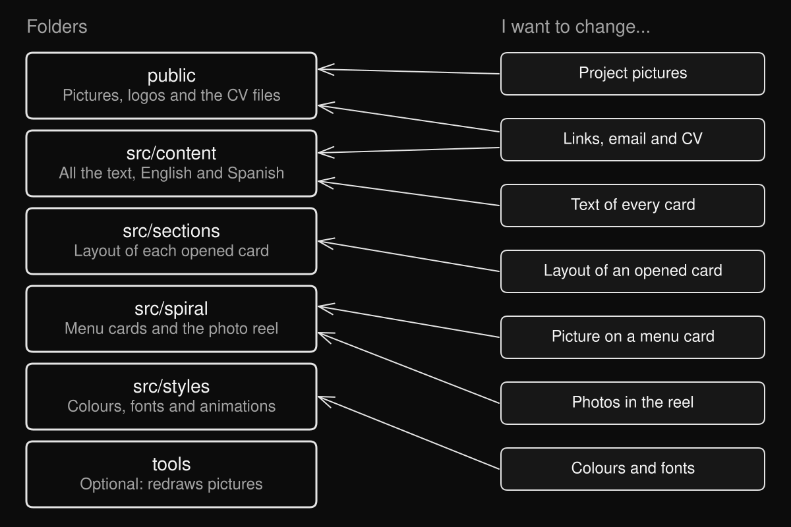

# Start here

This is your portfolio site. It has a spiral menu of 10 cards. Click a card (or press Enter) and a panel opens with that section. On phones, and for anyone with "reduce motion" turned on, you get a plain list of the same sections instead of the spiral. Everything is in English and Spanish, and the language button swaps all of it.

I kept the site easy to edit. You will touch three places 90% of the time: `src/content` for the text, `public` for the pictures, and `src/styles/theme.css` for colours and the font. Everything else is the machinery that draws the cards, and most of it you can leave alone.

Almost every file you might edit has a short note at the top in plain words. When a number can be changed on purpose (how long a photo stays on screen, how fast the ring text runs), it sits at the top of its file with a name and a comment.

## Where things live



```
portfolio/
  START-HERE.md          this guide
  index.html             browser tab title and tab icon (before the page loads)
  package.json           the commands: npm run dev, npm run build
  docs/                  the folder map picture above
  public/                every picture and file the site hands out untouched
    photos/              portrait, rowing photos, TECHO photos
    logos/               school and company logos
    tech-icons/          the small skill logos (Python, React...)
    project-pictures/    the picture on each project card
    cv/                  the two CV PDFs
  src/
    content/             ALL the text, one JSON file per section, English and Spanish together
    sections/            how each opened card is laid out (one file per card)
    spiral/              the 3D menu: card faces, corner badge, photo reel
      reel-photos/       the photos for the corner badge and the reel
    styles/              theme.css (colours, font) and effects.css (animations)
    components/          pieces shared by the panels: timeline, tech grid, menu drawer
    lib/                 small helpers and the list of skill logos
  tools/                 optional scripts that redraw pictures. The site never runs them
```

Two folders you never open: `node_modules/` (downloaded packages) and `dist/` (the built site, rebuilt every time).

## I want to...

### Change the text of a card

All the words are in `src/content`. Open the file for the card, find the sentence, change it. English and Spanish sit side by side in the same file, under `"en"` and `"es"`. If you only change `en`, Spanish keeps the old text.

| Card on the menu | File | What is inside |
| --- | --- | --- |
| Hello | `site.json` | `meta` (name, role, tagline, location), `links` |
| About me | `about.json` | `lead`, `points` |
| Experience | `experience.json` | a list of entries: period, role, org, place, logo, bullets |
| Things I work with | `skills.json` | `groups` (title and items), `other`, `languages` |
| Education | `education.json` | a list of entries: period, title, org, place, logo, url, bullets |
| Projects | `projects.json` | `groups`, `items` (one per project), `art` |
| Rowing | `rowing.json` | `lead`, roster link, `medals` |
| Learning | `learning.json` | `lead`, `points` |
| Leadership | `leadership.json` | `lead`, `items` |
| Contact | `contact.json` | `lead` (the email and buttons come from `site.json`) |

Button labels, the corner badge text, picture descriptions and the names of the menu cards are in `interface.json`. `src/content/README.md` explains every key.

### Change the picture, logo or colours of a menu card

Open `src/spiral/cardFaces.ts`. It is one table with an entry per card, named by the section id (`intro`, `about`, `experience`...). The fields:

- `photo`: `src` is the file in `public` (for example `/photos/portrait.webp`). `fx` and `fy` run from 0 to 1 and say which part of the photo stays in view when it is cropped. `fx: 0` keeps the left edge, `1` the right edge. `fy: 0` keeps the top, `1` the bottom.
- `logo`: the logo drawn on the card, as a file in `public`.
- `background`: one colour, or two colours for a diagonal gradient. Education uses three (white centre, then two blues).
- `lines`: the colour of the rings or outlines on top of the background.
- `logoColor`: the colour a logo is filled with, on the cards that recolour it.
- `titleColor`: `'white'` or `'dark'`, for the number and title. Use `'dark'` on light backgrounds.

Not every field works on every card. Photos only show on Hello, About me and Rowing. Logos only show on Experience and Education. If you set a field on a card that does not use it, nothing happens. To use a new photo, drop it in `public/photos/` and change `src`. If you replace a file keeping its name, the card changes with no edit at all. Note that `portrait.webp`, `rowing-paraguay.webp` and `rowing-hocr.webp` also appear inside the opened panels.

The font and sizes of the card artwork are in `src/spiral/cardStyle.ts`. The lime green on some cards is `ACCENT` there.

### Change the pictures inside the opened cards

- Hello: `public/photos/portrait.webp`. It is named in `src/sections/Intro.tsx`, in the `img` near the bottom.
- Rowing: `public/photos/rowing-paraguay.webp` and `public/photos/rowing-hocr.webp`. Both are named in `src/sections/Rowing.tsx`.
- Leadership (TECHO): `public/photos/techo-1.webp` and `public/photos/techo-2.webp`. They are named at the top of `src/components/Timeline.tsx`, and `leadership.json` chooses them with `"photos": ["techo1", "techo2"]`.

Easiest way: replace the file and keep the same name. If you give it a new name, change the name in the file listed above. A portrait about 2:3 works for Hello, and the TECHO photos are cropped to 3:4. The rowing photos are cropped to 4:3. Their descriptions for screen readers are under `alt` in `interface.json`, so update those too.

### Change a project card's picture

Project pictures live in `public/project-pictures/` and are named `<project-id>.<en|es>.<svg|webp>`. For example `sudoku.en.svg` and `sudoku.es.svg`. The id is the `id` of the project in `projects.json`. A project with `"image": "webp"` uses a `.webp` file, every other project uses `.svg`. The site picks the file from the language, so you need one picture per language.

Seven projects are diagrams (orquestador, pep9, vmm, sched, sudoku, db, web). They are drawn by a script, not by hand. To change the words in one, open `tools/project-diagrams/<id>.mjs`, edit the English and Spanish text in `strings` at the top, then run:

```
npm run pictures
```

That redraws all of them. For one only, run `node tools/project-diagrams/build.mjs sudoku`. It needs internet and Edge or Chrome. Do not edit the SVG files by hand. The next `npm run pictures` would overwrite your edit.

Three projects are screenshots (catch, dashboard, forecast), as `.webp`. They are made by the scripts in `tools/project-screenshots/`, and `tools/project-screenshots/README.md` has the steps for each. You can also just put any 1500 x 900 `.webp` in `public/project-pictures/` with the same file name.

The text that describes each picture for screen readers is `art` at the bottom of `projects.json`.

### Add photos to the corner badge and the photo reel

The corner badge is the small tilted photo at the bottom left of the spiral. Press it and the photo reel opens. Both use the same photos.

1. Drop your photos in `src/spiral/reel-photos/`.
2. Name them so they sort in the order you want: `badge-1.webp`, `badge-2.webp`, `badge-3.webp`, then `badge-10.webp` after `badge-9.webp`. Numbers are counted properly, so you do not need leading zeros.
3. Delete the three placeholder photos when you add your own. With an empty folder the badge shows a plain grey tile and pressing it does nothing.

That is all. No code to change. If the dev server does not show a new photo, refresh the page.

Size advice: about 1600 px on the long side, WebP or JPG (PNG works), under 160 kB each so the reel opens fast. In the reel every photo is shown whole, so wide, tall and square photos all work. The small tile is cropped to 16:9 and hangs off the corner, so only its top right part is visible. Keep the face in the upper right of the photo.

### Change how long a photo stays, or the ring text

- Seconds per photo on the small tile: `SECONDS_PER_PHOTO` in `src/spiral/CornerBadge.tsx` (3.2).
- How fast the ring text runs around the tile: `RING_SECONDS_PER_TURN` in the same file (12 seconds for one turn, smaller is faster).
- Seconds per photo inside the reel: `SECONDS_PER_PHOTO` in `src/spiral/PhotoReel.tsx` (1.7). `FADE_SECONDS` there is the crossfade.
- The ring text itself: `badgeRing` under `ui` in `src/content/interface.json`, in both `en` and `es`. The text is repeated to fill the ring, so a short phrase is fine. End it with a separator and a space, like the current one does.
- The tilt of the tile: `.badge-tile` in `src/styles/effects.css` (`rotate(-15deg)`).

### Change colours and fonts

Open `src/styles/theme.css`. It has a note on every group. The main ones:

- `--bg`: page background.
- `--fg`: main text colour.
- `--muted`: quieter text.
- `--surface`: panels and cards on top of the background.
- `--line`: thin borders.
- `--chip`: background of the small tag pills.
- `--accent-text`: colour of dates, small labels and numbers.
- `--color-accent`: the accent, white at the moment. Buttons, timeline dots, bullets and the progress bar follow it.
- `--color-ink`: text that sits on the accent (button labels). Keep it dark while the accent is light.
- `--font-sans`: the font.

To change the font: run `npm install @fontsource-variable/<font-name>`, add `import '@fontsource-variable/<font-name>'` in `src/main.tsx` next to the Inter line, and put the font's name in `--font-sans`. Spiral cards draw their titles on a canvas with their own copy of the name: `FONT` in `src/spiral/cardStyle.ts`, and the two `document.fonts.load` lines in `src/spiral/cardDrawing.ts`. Change those too or the cards keep Inter.

Colours that are not in `theme.css`:

- Menu card faces: `src/spiral/cardFaces.ts`, `cardStyle.ts` and a few inside `cardDrawing.ts` (the skill tiles, the chart on the Projects card).
- The globe behind the panels: `src/lib/vanta.ts` (`color`, `color2`, `backgroundColor`, written like `0xffffff`).
- The black behind the spiral and the floor grid: `BG` and `gridHelper` in `src/spiral/Spiral.tsx`.
- The medal metals: `TONES` at the top of `src/components/Medal.tsx`.
- Diagram pictures: `C` in `tools/project-diagrams/lib.mjs`, then `npm run pictures`.
- Phone browser bar colour: `theme-color` in `index.html`.
- A few colours written straight into components, such as `bg-black/50` or `border-white/20`. Search the file for the class if you want to change one.

### Change links, email, LinkedIn, GitHub or the CV

Open `src/content/site.json`. Under `links` you have `email`, `linkedin`, `github` and `cv`, once for `en` and once for `es`. Change both. Project links (`live`, `code`) are in `projects.json`, and the rowing roster link is `rosterUrl` in `rowing.json`.

The CV is a PDF in `public/cv/`: `Nicolas_Invernizzi_CV_EN.pdf` and `Nicolas_Invernizzi_CV_ES.pdf`. Replace the file and keep the same name, and the Download CV buttons pick it up. If you rename it, change `cv` in `site.json` to match.

### Change my name, title or tagline

In `site.json`, under `meta`: `name`, `role`, `tagline`, `location`, plus `title` (the browser tab and search result title) and `description` (the search result text). Do it in `en` and `es`. `index.html` also has a `<title>` and description. The site replaces them as soon as it loads, so they only matter for the first moment and for tools that do not run the page. Update them as well so they agree.

### Add a new project

1. In `src/content/projects.json`, copy an entry in `items` (in `en` and in `es`) and edit it. Fields: `id`, `group` (one of the `groups` ids: itti, rowing, systems, web), `title`, `tag`, `text`, `details` (bullets), `stack` (tech names), and optionally `legal`, `note`, `live`, `code`, `codeLabel`, `image`.
2. Add its picture to `public/project-pictures/`: `<id>.en.svg` and `<id>.es.svg`, or `.webp` files with `"image": "webp"` on the project.
3. Add a description for the picture under `art` at the bottom of the file, as `"<id>": { "label": "..." }`, in both languages.
4. `stack` names show as plain text tags on the project card. No logo is needed.

### Add a skill logo

1. Save the logo as `public/tech-icons/<slug>.svg`. A white or light logo works best on the black tiles.
2. Add one line to `src/lib/techIcons.ts`: the name as you write it in `skills.json`, then the slug and the label shown on hover.
3. Use that name in `skills.json`, under `items` (spell it exactly the same, capital letters count).

A name in `skills.json` that is not in `techIcons.ts` still shows up, just as a plain text tag. The Skills menu card shows the logos of the first 30 skills that have one.

### Replace a school or company logo

The logos inside the Experience and Education panels are listed in `LOGOS` in `src/components/ui.tsx`. Replace the file in `public/logos/` keeping its name, or change `src` there. The logos on the menu cards are different files (`itti-white.svg` and `marietta.svg`), set in `cardFaces.ts`.

The light versions used on the black panels (`marietta-dark.svg`, `cambridge-dark.png`) are made from `marietta.svg` and `cambridge.png` by `tools/logos-and-icons/make-dark-logos.py`. If you replace one of those two originals, run that script (the steps are in `tools/logos-and-icons/README.md`).

### Change the Education or Experience entries

Open `education.json` or `experience.json`. Each entry in the list is one block on the timeline. Add, remove or reorder entries, in `en` and in `es`. `logo` picks a logo from `LOGOS` (itti, marietta, cambridge, cristorey, techo). `url` makes the org name a link, and `"urlOn": "title"` makes the heading the link instead. Education currently has the school links in `url`.

### Change the medals

In `src/content/rowing.json`, under `medals`. Each has `medals` (`["silver"]`, `["bronze"]`, or both), `label`, `event`, `place` and `year`. The medal drawing is `src/components/Medal.tsx`.

### Change the order or names of the menu cards

In `src/content/interface.json`, the `sections` list, once in `en` and once in `es`. The order of that list is the order around the spiral, and it sets the number on each card. `title` is the name shown on the card, in the menu and in the panel. Do not change an `id`: the code uses it to find the card's layout and its face. If you reorder, do it the same way in both languages.

### Add a whole new section

Say you want a "Pets" card. The easiest way is to copy a simple section, like Learning, and rename.

1. Text: copy `src/content/learning.json` to `src/content/pets.json` and edit it (both languages).
2. Merge it: in `src/content/index.ts` add `import pets from './pets.json'` and the line `pets: pets[lang],` inside `build()`. Add `pets: { lead: string; points: string[] }` to the `Content` type in `src/lib/content.ts`.
3. Layout: copy `src/sections/Learning.tsx` to `src/sections/Pets.tsx`, rename the function, and read from `pets`.
4. Register it: in `src/sections/registry.tsx` import `Pets` and add `pets: Pets,` to the table.
5. Menu entry: add `{ "id": "pets", "title": "Pets" }` to `sections` in `interface.json` (both languages), in the place where you want the card.
6. Card face: add a `pets` entry to `CARD_FACES` in `src/spiral/cardFaces.ts`. Then add a `pets` painter to the `PAINTERS` table in `src/spiral/cardDrawing.ts` (copy `learning` or `contact` and edit it). Without a painter the card has no background, only its number and title.
7. Run `npm run build`, then look at the spiral. The build catches code mistakes. It cannot tell you that a card has no painter.

### Change the speed of the spiral

`WHEEL_SPEED` (mouse wheel and trackpad) and `DRAG_SPEED` (mouse and finger drag) at the top of `src/lib/useScrollProgress.ts`. A bigger number is faster. How softly the cards glide to a stop is the `6` in the `useFrame` line of `src/spiral/Spiral.tsx` (bigger is snappier).

### Run it, check it and put it online

```
npm run dev       # opens a live preview at http://localhost:5173
npm run build     # checks the code and builds the site into dist/
```

`npm run dev` updates the page every time you save a file. Run `npm run build` before you push. If it passes, the site will build on Vercel too. On this computer npm sometimes fails because of a broken entry in the system PATH. If that happens, run these two instead, from PowerShell:

```
node node_modules/typescript/bin/tsc -b
node node_modules/vite/bin/vite.js build
```

To go live, push to GitHub (branch `main`). Vercel rebuilds by itself, and the new version is up in about a minute. On this project, ask Claude to commit and push.

## Rules that save you from breaking it

- Change English and Spanish together. They are separate texts, and nothing translates for you.
- When you swap a picture, keep the file name. If you change the name, change it everywhere it is written (the section notes above say where).
- Run `npm run build` before you push.
- Do not edit `dist/` or `node_modules/`. They are rebuilt and your edits would be lost.
- JSON is strict. Every item except the last in a list needs a comma, and text needs straight double quotes, like "this". A quote inside text needs a backslash in front: `\"`. Do not leave a comma after the last item.
- If you make a typo, the build stops and names the file and line (for a JSON mistake it says where the JSON broke). Fix that spot and run it again.
- Keep the same set of keys in `en` and `es`. A key that exists in one and not the other leaves a blank in that language.
- Do not rename a section `id` or a project `id` without renaming everything that uses it (pictures, card faces, registry).

## Files you should not need to touch

- `src/spiral/Spiral.tsx`, `Card3D.tsx`, `SpiralHud.tsx`, `SpiralBoundary.tsx`: the 3D engine and the on-screen controls of the spiral.
- `src/spiral/badgePhotos.ts`: reads the reel photos folder.
- `src/lib/useFocusTrap.ts`, `usePresence.ts`, `useReducedMotion.ts`: keyboard focus, open and close animations, reduced motion.
- `src/components/Panel.tsx`, `MenuDrawer.tsx`, `TopBar.tsx`, `ListView.tsx`, `TechGrid.tsx`, `VantaGlobe.tsx`: the frame around the sections.
- `src/App.tsx`, `src/main.tsx`, `src/i18n.ts`: start-up and language.
- `vite.config.ts`, `tsconfig.json`, `package-lock.json`: build settings.
- Everything in `tools/` unless you are redrawing a picture.
