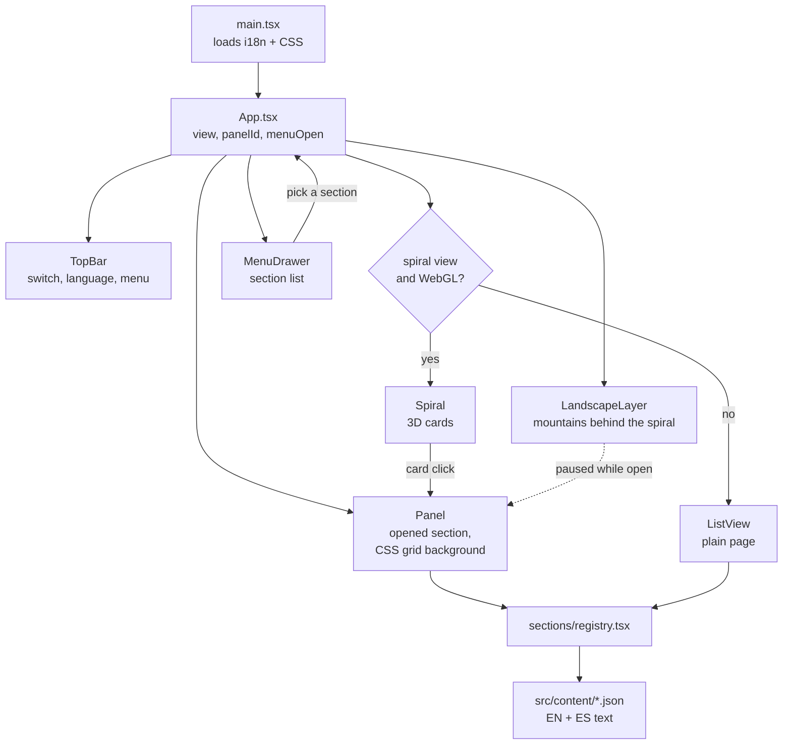

# How the site works (flowcharts)

These pages explain how the main parts of the site fit together, with a diagram for each. They're for understanding and fixing things. To change text, pictures or colours, [START-HERE.md](../../START-HERE.md) is quicker.

GitHub draws the diagrams on its own. In VS Code you need a Mermaid preview extension.

## The pages

- [spiral.md](spiral.md): the 3D spiral menu. How scrolling moves the cards, how each card face gets painted, the corner badge and photo reel, and the fallback to the list.
- [landscape-background.md](landscape-background.md): the animated mountain background behind the spiral. When it loads, when it pauses, and how the shader draws it.
- [panels-and-content.md](panels-and-content.md): how a section's text goes from a JSON file to the screen, the language switch, and the project cards (photos vs. clickable diagrams).
- [top-bar-and-menu.md](top-bar-and-menu.md): the top bar (spiral/list switch, language button) and the slide-in menu.

## The whole app on one page

`src/App.tsx` is the boss. It holds four bits of state, and every part of the screen reads from them:

- `view`: `'spiral'` or `'list'`.
- `panelId`: which section is open in a panel (`null` = none).
- `menuOpen`: is the slide-in menu showing.
- `webgl`: can this browser draw 3D at all. WebGL is the browser's way of using the graphics card.

How to read it:

- On first load, `App` picks the spiral only if there's WebGL, the window is at least 768 px wide, and "reduce motion" is off. Otherwise you get the list.
- Spiral and list never show together. The spiral sits inside `SpiralBoundary`, so if the 3D crashes (or WebGL gets lost) `failSpiral` turns WebGL off and switches to the list.
- Panels only open from the spiral. In the list view, picking a menu item just scrolls to that section.
- `LandscapeLayer` only runs in the spiral view. It keeps one full-screen mountain canvas under the spiral and pauses it while a panel is open. Panels have a plain CSS grid-floor background instead, so they open instantly.
- Panel and ListView both ask `src/sections/registry.tsx` which component draws a section. Every component gets its text from `src/content`.

## Where to change things

- Which view you start on, and the 768 px cutoff: the `useState<View>` line in `src/App.tsx`.
- What happens on a menu pick: `selectFromMenu` in `src/App.tsx`.
- Page scroll is locked while the spiral or the menu is showing: the `no-scroll` class, toggled in `src/App.tsx`, styled in `src/styles/theme.css`.
