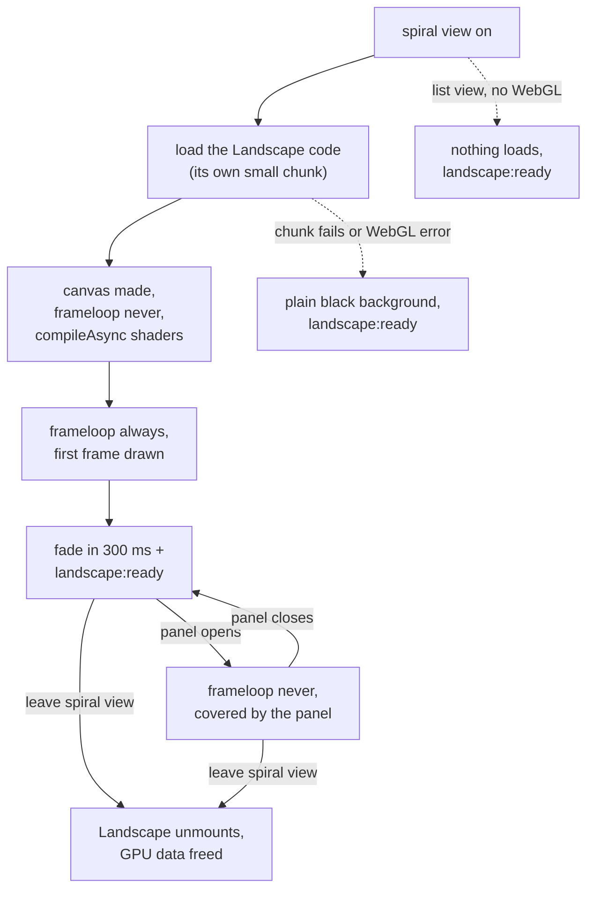
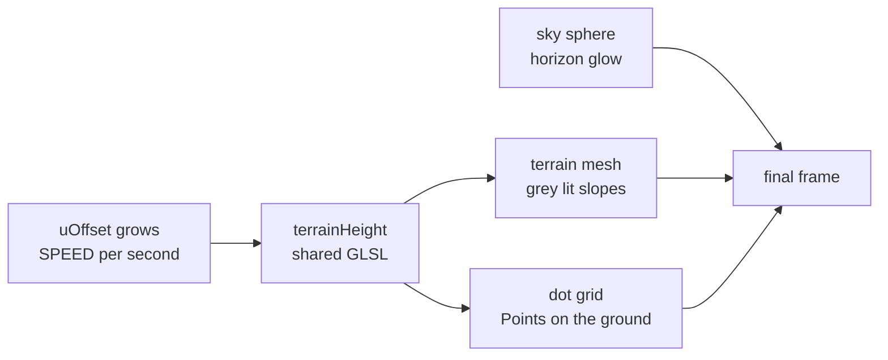

# The landscape background

Behind the 3D spiral there's a slow night landscape: dark mountains and a valley covered in a grid of glowing dots, a soft glow at the horizon, all drifting toward you. It's one WebGL canvas, full screen, sitting under the spiral's own canvas. The spiral canvas is transparent, so the mountains show between and behind the cards.

It only exists in the spiral view. The list view never loads it.

Panels don't use it. When a panel opens it's covered, so the landscape just stops drawing. The panel has its own background, a black perspective grid floor made of plain CSS (`src/components/GridBackdrop.tsx`), so a panel opens instantly with nothing to compile.

One word you'll see a lot: `frameloop`. It's the React Three Fiber setting for when the canvas redraws. `'always'` redraws every frame (about 60 times a second), `'demand'` only redraws when the code asks for it, and `'never'` doesn't redraw at all.

## Life cycle: one canvas for the spiral view

Two files share the job:

- `src/components/LandscapeLayer.tsx` loads it, catches failures, and throws it away when the spiral goes.
- `src/components/Landscape.tsx` is the canvas and the drawing.

Step by step:

1. **Load.** As soon as the spiral view is on, `LandscapeLayer` loads the landscape code. Vite splits it into its own small file (a chunk), so the list view never downloads it. If the chunk fails to load, a fallback component stands in.
2. **Compile.** The canvas starts paused (`'never'`). `Scene` calls `gl.compileAsync` to compile the shaders (small programs that run on the graphics card, the GPU) without freezing the page. Only then does `frameloop` switch on.
3. **First frame.** When the first frame has actually been drawn, the canvas fades in over 300 ms (it's invisible before that) and the preloader is told (see below).
4. **Pause.** `App` passes `open` (a panel is showing) to `LandscapeLayer`, which passes `paused` to `Landscape`. While paused, `frameloop` is `'never'`: the GPU does no work. Closing the panel resumes it. The last frame stays on screen meanwhile, so nothing flashes.
5. **Leave the spiral.** Switching to the list (or `failSpiral` after a 3D crash) sets `enabled` false. `LandscapeLayer` renders nothing, so `Landscape` unmounts, calls `disposeAssets()` to free the GPU memory, and React Three Fiber releases the WebGL context. Switching back builds a fresh canvas.

**Telling the preloader.** `src/lib/landscapeReady.ts` has `signalLandscapeReady()`. It sets `window.__landscapeReady = true` and fires `landscape:ready` on `window`, once only. It runs on the first drawn frame, when the chunk or WebGL fails (`LandscapeBoundary` and the chunk fallback), when the list view is shown (nothing will load), and as a 10 s safety timer in `LandscapeLayer` in case a first frame never comes.

**Pointer and scroll.** The landscape layer has `pointer-events: none` and sits below the spiral, so wheel, drag and clicks all reach the spiral as before. The mouse also sways the landscape camera a little.

## How the picture is drawn

There are three objects: a sky sphere, a terrain mesh, and a grid of dots. The terrain and the dots both read heights from one shared function, `terrainHeight` in `HEIGHT_GLSL`, so the dots always sit exactly on the slopes.

**The height function** (all in GLSL, the shader language):

- It uses simplex noise (`snoise`), a smooth random bumpy pattern.
- **Mass:** two smooth noise samples make the broad, rolling shape of the mountains.
- **Crags:** two "ridged" samples (`1 - abs(noise)`) make sharp crests. They're multiplied by the mass, so crags only show on top of the big shapes, not in the valley.
- **Envelope:** the mountains grow with distance (`far`) and toward the left and right edges (`side`), leaving a calm basin in the middle.
- **Motion:** the noise is read at `z - uOffset`. `uOffset` grows every frame, so the ground flows toward you and never repeats. The mesh itself never moves.

**Lighting:** the slope at a point (its normal) comes from finite differences. `terrainNormal` asks for the height a little to the right and a little ahead, and the difference gives the tilt. The light comes from the upper left (`LIGHT`).

**Haze and fog:** far terrain fades into a grey haze (`FOG`, `HAZE`). The sky sphere glows the same grey just above the horizon and goes black higher up, so the two blend.

**The dots:** each dot has a fixed grid cell (`aCell`). The shader wraps its depth with `mod`, so rows that pass the camera come back at the far end. Each dot gets:

- Twinkle: a slow flicker, its speed set by a random seed per dot (`TWINKLE`). One dot in ten is bigger and brighter.
- Row fade: new rows fade in at the far end, so you never see them pop in.
- Side fade (`EDGE`): terrain and dots fade into haze toward the left and right edges, so the edge of the mesh never shows.
- Near fade: dots right in front of the camera fade out.

The mouse sways the camera a little (`PARALLAX`). Touch doesn't, so scrolling on a phone doesn't wobble it.

## Phones, sharp screens and reduced motion

- DPR is device pixel ratio: how many real screen pixels make one CSS pixel. A higher DPR looks sharper but costs a lot more GPU. The landscape caps it at 1.5 (1 on small screens). The spiral itself allows up to 2.
- **Small path.** `isSmall` is true under 768 px wide or when the device pixel ratio is over 2. Then the terrain mesh is lighter (170 x 130 squares instead of 260 x 210), the dots sit 1.6 times further apart, and the pixel ratio stays at 1.
- `isSmall` is checked once when the canvas is made. Resizing the window later doesn't switch paths.
- On phones the app starts in the list view, so this lighter path only runs if you switch to the spiral.
- **Reduced motion.** `frameloop` is `'demand'`, so it draws one still frame: no drift, no twinkle, no camera sway, and no fade-in. (The app starts in the list view with reduced motion on, so this only runs if you switch to the spiral.)

## Where to change things

All in `src/components/Landscape.tsx`, in the `Knobs` block at the top:

- `SPEED`: how fast the ground drifts toward you.
- `DOT_SPACING`, `DOT_SIZE`, `DOT_COLOR`: the dot grid.
- `SLOPE_COLOR`: colour of the lit slopes.
- `FLOOR_HEIGHT`, `RIDGE_HEIGHT`, `SIDE_HEIGHT`: valley roughness, mountain height far away, extra height at the sides.
- `NOISE_SCALE`: lower means wider mountains. `CRAG`: how sharp the crests are.
- `FOG`: higher means a shorter view. `HAZE`: brightness of the horizon glow.
- `TWINKLE`: 0 for steady dots, 1 for strong flicker.
- `PARALLAX`, `CAMERA`: camera sway and position.

Other places:

- Mesh detail and the small-screen rules: `getAssets` and `isSmall` in `Landscape.tsx`.
- Pixel ratio caps: the `dpr` prop on `<Canvas>` in `Landscape.tsx`.
- Fade-in time: the `opacity 300ms` style on `<Canvas>` in `Landscape.tsx`.
- The panel background (grid colours, cell size, where the horizon sits): the constants at the top of `src/components/GridBackdrop.tsx`.
- The dark vignette over the spiral and landscape (so the cards and HUD stay readable): the gradient `div` in `src/spiral/Spiral.tsx`; fog on the cards: the `<fog>` line there.

## Gotchas

- If WebGL fails or the code chunk won't load, the spiral background just stays plain black. `LandscapeBoundary` catches the error. Nothing else breaks.
- The terrain and dots both use `HEIGHT_GLSL`. Change the height function there, not in only one shader, or the dots float off the ground.
- The shape, fog, haze and twinkle knobs are written into the shader text as numbers when the file loads (`${RIDGE_HEIGHT.toFixed(1)}` and so on). If a saved change to one of those doesn't show, reload the page.
- The spiral canvas must stay transparent (`alpha: true`, and no `<color attach="background">` in `Spiral.tsx`), or it will hide the landscape.
- Run `performance.getEntriesByName('landscape:first-frame')` in the browser console to see when the first frame landed (ms since page load). It's a timing mark only.
