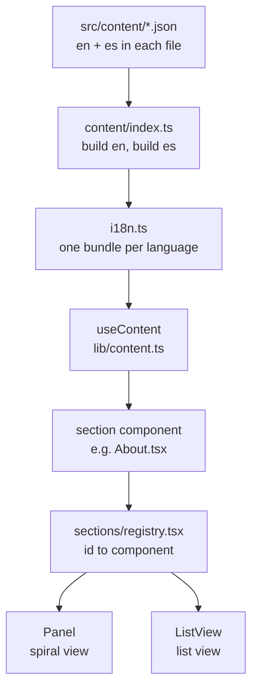
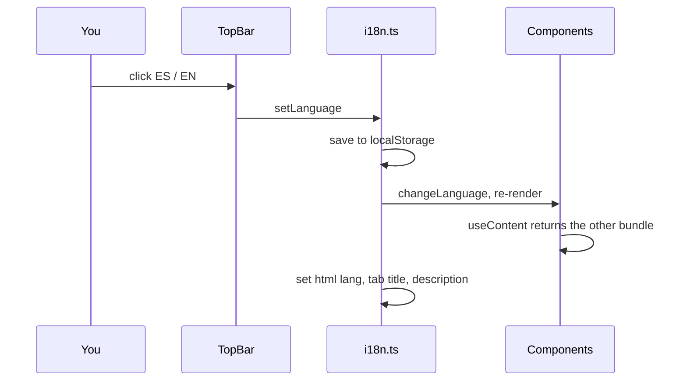
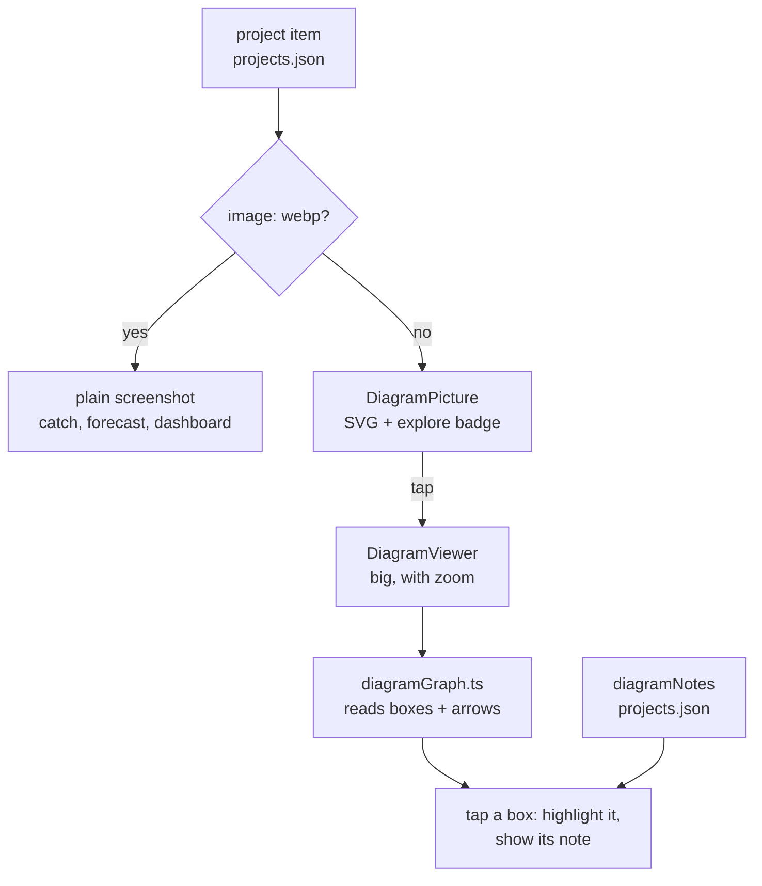
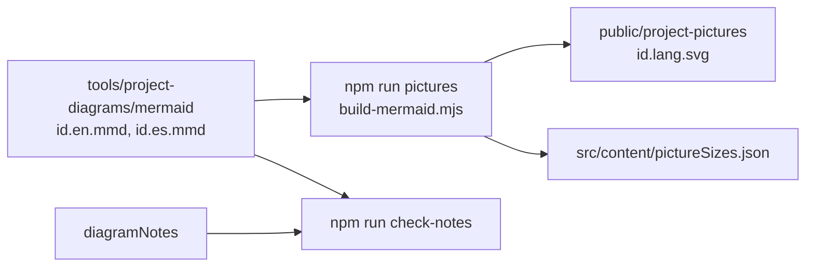

# Panels and content: from JSON to the screen

None of the text on the site lives in the components. It's all in `src/content/*.json`, one file per section, with English and Spanish side by side. The components only decide the layout. So changing a sentence never means touching React code, and both languages stay in one place where you can see if one is missing.

## How a section's text reaches the screen

1. **The JSON files.** Every file looks like `{ "en": {...}, "es": {...} }`. `src/content/README.md` says what each key means.
2. **`src/content/index.ts`** imports every file and runs `build('en')` and `build('es')`. Each one makes a single object for that language: `ui`, `alt`, `meta`, `links`, `sections`, `about`, `experience`, `projects`, and so on.
3. **`src/i18n.ts`** hands both objects to i18next (the translation library) as its two resource bundles. It doesn't use translation keys like `t('about.lead')`. The whole object is the bundle.
4. **`useContent()`** in `src/lib/content.ts` returns the bundle for the current language. The `Content` type there describes its shape, so TypeScript catches a mistyped field name in component code. It can't check the JSON itself: `useContent` just tells TypeScript to trust that the bundle has that shape (`as Content`).
5. **A section component** (like `src/sections/About.tsx`) calls `useContent()` and reads `c.about.lead`, `c.about.points`, and so on.
6. **`SECTION_VIEWS`** in `src/sections/registry.tsx` maps each section `id` to its component. `Panel` shows one of them. `ListView` shows all of them, one after another.

The list of sections, their order and their titles come from `sections` in `src/content/interface.json`. That one list drives the spiral cards, the menu, the panel header (`03 / 10`) and the list view.

## Panel vs. list view

Both use the same `SECTION_VIEWS[id]` component for a section. The difference is the frame around it.

- **Panel** (`src/components/Panel.tsx`) opens over the spiral. It finds the section by `id`, shows its number and title in a header, and draws the section's component in a scrolling area. Its background is `GridBackdrop` (`src/components/GridBackdrop.tsx`): black, a perspective grid floor fading into the dark, and a vignette, all plain CSS with no WebGL, so it appears instantly. Esc, the close button or a click outside closes it. Focus stays inside while it's open (`useFocusTrap`), and the enter/exit animation comes from `usePresence`.
- **ListView** (`src/components/ListView.tsx`) is one long page. It draws `Intro` itself, as the big hero at the top (`<Intro hero />`), then every other section with a numbered heading, then footer links from `site.json`. If the address has `#projects` (or any section id), it scrolls there on load.

## Switching language

- The choice is saved under `portfolio-lang` in `localStorage`. On a first visit the browser's language decides (Spanish if it starts with `es`, otherwise English).
- Everything re-renders with the other bundle: panel text, menu, spiral card titles (each card repaints), and the project pictures, which are separate files per language.

## Project cards: photos vs. clickable diagrams

Each project in `projects.json` gets a card in `src/sections/Projects.tsx`. The picture is `public/project-pictures/<id>.<en|es>.<svg|webp>`.

- **Photo projects** (`"image": "webp"`) just show the screenshot, fading into the card.
- **Diagram projects** (no `image` field) show an SVG with a small "tap to explore" badge. Tapping opens `DiagramViewer` (`src/components/DiagramViewer.tsx`) in a full-screen dialog.
- The viewer fetches the SVG text and puts it into the page as real SVG, not an ``, so each box can be clicked. `readDiagram` in `src/lib/diagramGraph.ts` finds the boxes and arrows from the ids Mermaid gives them (`flowchart-<id>-<n>` for a box, `L_<from>_<to>_<n>` for an arrow).
- Tapping or hovering a box calls `highlight`. It lights that box and every box it's joined to, and dims the rest. The footer shows the box label and its note from `diagramNotes.<project id>.<box id>`.
- The viewer has zoom buttons, but never starts so small that the text goes under `MIN_TEXT_PX`. It scrolls instead.

### Where the diagram pictures come from

- The diagrams are written as Mermaid text (`.mmd`), one per project and language.
- `npm run pictures` runs `tools/project-diagrams/mermaid/build-mermaid.mjs`. It loads Mermaid from a CDN (a public server that hosts code libraries) in a hidden Edge or Chrome window, draws every diagram, and writes the SVGs plus `pictureSizes.json` (each picture's width and height, so the card saves the right space while it loads). It needs internet and Edge or Chrome. Without them it changes nothing.
- `npm run check-notes` runs `tools/check-diagram-notes.mjs`. It checks that every box in every `.mmd` and every built SVG has a note in both languages, that no note points at a box that doesn't exist, that no note is over 120 characters, and that `interface.json` has the same `ui` keys in `en` and `es`.

## Where to change things

- Any text: the matching file in `src/content/`. Both `en` and `es`.
- Section order and titles: `sections` in `src/content/interface.json`.
- Layout of one section: its file in `src/sections/`.
- Panel frame, header and the dark gradient: `src/components/Panel.tsx`.
- Footer links in the list view: `links` in `src/content/site.json`.
- A project's card: its item in `projects.json`. Screen-reader text for its picture: `art.<id>.label`.
- Diagram box notes: `diagramNotes` in `projects.json`, then `npm run check-notes`.
- A diagram's boxes and arrows: `tools/project-diagrams/mermaid/<id>.<lang>.mmd`, then `npm run pictures`.
- Viewer zoom: `MIN_TEXT_PX`, `ZOOM_STEP`, `MAX_ZOOM` in `src/components/DiagramViewer.tsx`. Highlight look: `.dv-*` in `src/styles/effects.css`.
- Where a picture starts fading into the card: `solid` in `ProjectCard`, `src/sections/Projects.tsx`.

## Gotchas

- A new field in a JSON file also needs adding to the `Content` type in `src/lib/content.ts`. A brand new section needs an import and a line in `build()` in `src/content/index.ts`, a line in `SECTION_VIEWS`, and a card face (see [spiral.md](spiral.md)). The full checklist is in START-HERE.md.
- A key missing in one language shows up blank in that language. Nothing warns you, except `check-notes` for `ui` keys and diagram notes.
- The Intro section is drawn two ways: the registry's `intro` entry (used by Panel) and `<Intro hero />` (used by ListView, bigger).
- A project `id` is also its picture file name. Rename one, rename the other.
- Don't hand-edit `public/project-pictures/*.svg` or `pictureSizes.json`. The next `npm run pictures` overwrites them.
- `npm run pictures` with no ids redraws everything, `docs/folder-map.svg` included. To redraw one diagram: `node tools/project-diagrams/mermaid/build-mermaid.mjs sudoku`.
