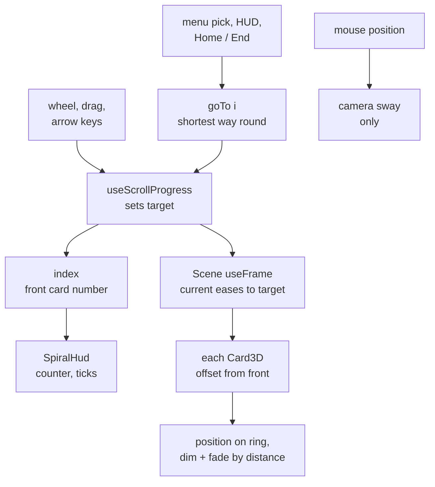
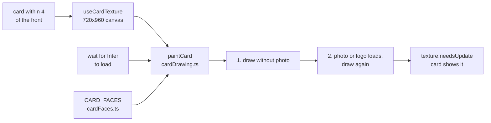
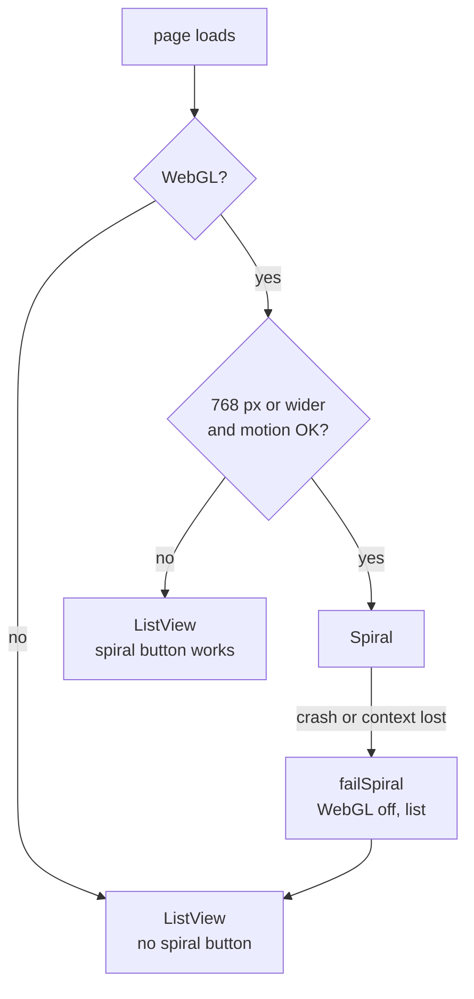

# The 3D spiral menu

The spiral is the home screen on a computer: one card per section, wound around a ring that you scroll through forever. It's drawn with three.js through React Three Fiber (R3F, a way to write a three.js scene as React components). Each card's artwork isn't an image file. It's painted in code on a plain 2D canvas, and that canvas is glued onto the 3D card as a texture (a picture wrapped onto a 3D shape).

All the code is in `src/spiral/`, plus `src/lib/useScrollProgress.ts` for the scrolling.

## Scrolling moves the cards, not the camera

Wheel, drag or arrow keys never move the camera. They move one number, the spiral position, and every card works out where it should sit from that number on each frame.

What happens, step by step:

1. `useScrollProgress` keeps two numbers. `target` is where you asked to go. `current` is where the cards are right now. Both can grow forever (no wrapping), so easing never takes the long way round.
2. The wheel adds `deltaY * WHEEL_SPEED`. A drag adds `distance * DRAG_SPEED`. Arrow keys and Page Up/Down step one card. Home and End jump to the first and last card.
3. On every frame, `Scene` (in `Spiral.tsx`) slides `current` toward `target`. The `6` in `1 - Math.exp(-6 * dt)` sets how soft the stop feels.
4. Each `Card3D` asks `ringDelta`: "how many cards am I from the front?" That gives a number like -2.3. From it the card sets its spot on the ring (`RADIUS`, `STEP`, `RISE`), its brightness, and its fade. Cards more than about 5 away are hidden.
5. The camera only sways a little with the mouse, and backs away on very narrow screens so the front card fits (`FIT_WIDTH_FACTOR`).

The canvas stops redrawing (`frameloop` set to `'never'` instead of `'always'`) whenever a panel, the menu or the photo reel covers it.

## How a card face gets painted

- A card only makes its canvas once it gets near the front (`near` in `Spiral.tsx`). Far cards stay blank until you scroll toward them, which keeps the first load light.
- `paintCard` waits for the Inter font, because canvas text falls back to a system font if the web font isn't loaded yet.
- It draws twice. First right away without the picture, then again once the photo or logo has loaded. If the picture fails to load, the first drawing stays.
- `draw` clips the canvas to a rounded rectangle, runs the card's painter from the `PAINTERS` table, darkens the bottom of photo cards, then draws the number badge and title. The title tries sizes from 88 px down to 40 px until it fits in two lines.
- The Skills card is special. Instead of one picture, it loads a tech logo for each skill (`TECH_ICONS` in `src/lib/techIcons.ts`, files in `public/tech-icons/`) and lays them out in a 6-column grid.
- Changing language changes the title, and that repaints the card.

## The HUD, corner badge and photo reel

The HUD is everything flat on top of the 3D canvas (`SpiralHud.tsx`):

- Bottom left: the `01 / 10` counter and the front card's title.
- Bottom middle: the "scroll to explore" hint. It fades out once you leave the first card.
- Right side (computer only): one tick per card. Click a tick to jump there.
- Phone: a thin progress bar along the bottom.
- An invisible list of buttons, one per section, for keyboard users. Tab to one and the spiral turns to it. Press Enter and it opens.

- `CornerBadge` is the tilted photo tile in the bottom-left corner, with text running around it. It only shows on screens 768 px and wider, and hides while a panel or the menu is open.
- It swaps photos every `SECONDS_PER_PHOTO`. It only downloads a photo when its turn comes.
- Clicking it opens `PhotoReel`, a dialog that plays all the photos with a crossfade. Arrow keys and swipes step through them.
- While the reel is open, the spiral ignores scrolling and stops drawing (`reelOpen` in `Spiral.tsx`).

## Opening a panel

Click a card (a drag longer than 8 px doesn't count, so dragging the spiral never opens one), press Enter while nothing has focus, or pick it from the menu. `open(i)` turns the spiral to that card and calls `onOpen(id)`. `App` sets `panelId` and the panel appears. See [panels-and-content.md](panels-and-content.md).

## When the spiral isn't used

- `hasWebGL()` in `App.tsx` makes a throwaway canvas once to check.
- `SpiralBoundary` is an error boundary (a React wrapper that catches a crash inside it instead of blanking the page). If the 3D scene throws, it calls `failSpiral`.
- If the browser drops the graphics context while the spiral is showing (`webglcontextlost`), that also calls `failSpiral`. A context lost during a normal unmount is ignored.
- With "reduce motion" on, cards stop bobbing, the badge stops cycling and its ring text stops moving.

## Where to change things

- Scroll speed: `WHEEL_SPEED`, `DRAG_SPEED` in `src/lib/useScrollProgress.ts`.
- How softly cards glide to a stop: the `6` in the `useFrame` line in `src/spiral/Spiral.tsx`.
- Ring shape: `RADIUS`, `STEP` (turn per card), `RISE` (drop per card), `WIDTH` (card size) in `src/spiral/Card3D.tsx`.
- Camera distance, fog and the edge vignette: `CAMERA_Z`, `BG`, `<fog>` and the gradient `div` in `src/spiral/Spiral.tsx`. The spiral canvas is transparent; the mountains behind it are `src/components/Landscape.tsx` (see [landscape-background.md](landscape-background.md)).
- A card's photo, logo or colours: its entry in `CARD_FACES` in `src/spiral/cardFaces.ts`.
- Card size, font, `ACCENT`, `INK`, `OFFWHITE`: `src/spiral/cardStyle.ts`.
- The shape of a drawing, or a painter for a new card: `PAINTERS` in `src/spiral/cardDrawing.ts`.
- Badge and reel photos: `PHOTOS` in `src/spiral/badgePhotos.ts`.
- Badge timing and size: `SECONDS_PER_PHOTO`, `RING_SECONDS_PER_TURN`, `TILE_W`, `TILE_H` in `src/spiral/CornerBadge.tsx`. The tilt and hover wobble are `.badge-tile` in `src/styles/effects.css`.
- Reel timing: `SECONDS_PER_PHOTO`, `FADE_SECONDS`, `SWIPE_PX` in `src/spiral/PhotoReel.tsx`.
- Hint and badge text: `ui.scrollHint`, `ui.badgeRing`, `ui.badgeLabel`, `ui.reel*` in `src/content/interface.json`.

## Gotchas

- A new section needs a `CARD_FACES` entry and a painter in `PAINTERS`. Without a painter the card has no background, just the number and title. The build won't warn you.
- If you change `CARD_W` or `CARD_H`, every painter's numbers are laid out for 720 x 960. Check every card.
- A new font has to be changed in three places for the cards: `FONT` in `cardStyle.ts` and both `document.fonts.load` lines in `cardDrawing.ts`.
- Card order and numbers come from the `sections` list in `src/content/interface.json`, not from `CARD_FACES`.
