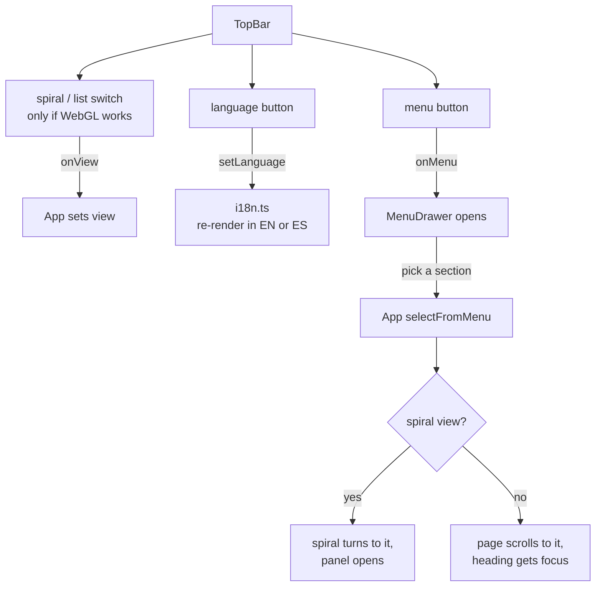

# Top bar and menu

The top bar (`src/components/TopBar.tsx`) is always on screen: your name on the left, the spiral/list switch in the middle, and the language and menu buttons on the right. The menu button opens `MenuDrawer` (`src/components/MenuDrawer.tsx`), a panel that slides in from the right with a numbered list of every section.

- **Switch.** Two buttons, `spiral` and `list`, with `aria-pressed` on the active one. Without WebGL the switch isn't drawn at all. The bar is see-through over the spiral and gets a blurred dark background in the list view (`solid`).
- **Letter hop.** Each letter of the switch words is its own `` with its position in `--i`. On mouse hover or keyboard focus, the `.hop` rules in `src/styles/effects.css` give each letter its own colour and a small jump, one after another, 45 ms apart. Brighter colours on the dark bar, deeper ones on the white active pill. With "reduce motion" on, the jump is off. The button's `aria-label` keeps the whole word for screen readers.
- **Language button.** It shows the other language (`ES` while in English) and calls `setLanguage`. See [panels-and-content.md](panels-and-content.md#switching-language).
- **Menu drawer.** Lists `sections` from `interface.json`. Esc, the close button or a click outside closes it. While it's open, the spiral stops reacting and drawing.

## Where to change things

- Switch words: `ui.spiral` and `ui.list`. Menu and close words: `ui.menu`, `ui.close`. Language button label: `ui.lang`. All in `src/content/interface.json`.
- Hop colours and timing: `.hop`, `.hop-l` and `@keyframes hop-lift` in `src/styles/effects.css`.
- Drawer slide animation: `.drawer-enter` and `.drawer-open` in `src/styles/effects.css`.
- Drawer width: `w-[min(100%,26rem)]` in `src/components/MenuDrawer.tsx`.
- The email under the menu list: `links.email` in `src/content/site.json`.
- What a menu pick does: `selectFromMenu` in `src/App.tsx`.

## Gotchas

- The hop colours repeat every 5 letters (`nth-child(5n + 1)` and so on). A longer word just cycles through them again.
- Your name in the top bar is only shown from 768 px up. In the spiral view, clicking it does nothing (it would jump to `#intro`, which only exists in the list view).
